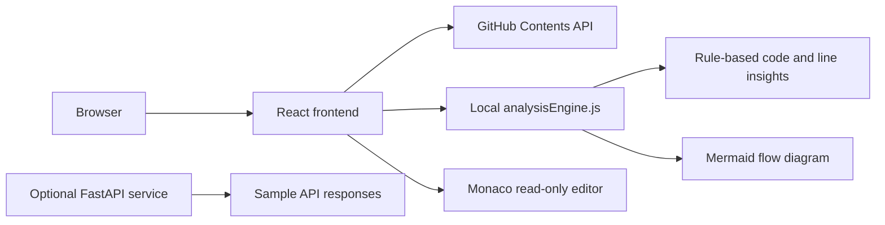

# Astra Vision

**Astra Vision** is an experimental, browser-based code exploration and learning workspace. It combines a GitHub repository browser, a read-only code editor, rule-based JavaScript analysis, interactive line insights, and Mermaid flow diagrams.

> **Project status:** Prototype. The checked-in frontend analysis engine is heuristic and JavaScript-focused. The accompanying FastAPI service currently exposes development endpoints with sample responses; it is not yet a production AI-analysis backend or a secure code-execution sandbox.

## What it does

- **Explore public GitHub repositories** — enter a repository URL to browse its folders and files through the GitHub Contents API.
- **Read source code in the editor** — view files in Monaco Editor with syntax highlighting and multiple open tabs.
- **Inspect JavaScript structure** — extract common function declarations, variable declarations, `console.log` calls, and return statements using regular-expression-based analysis.
- **Understand code with guided insights** — view rule-based explanations of code patterns and selected lines.
- **Visualize control flow** — generate Mermaid flow diagrams from the analysis engine's extracted code patterns.
- **Experiment with simple expressions** — use the interactive learning panel to change input values and observe supported expression results.
- **Fall back to a demo repository** — the frontend loads a small built-in sample project if a GitHub request fails or hits a rate limit.

The editor can display several common file types, but the current analysis engine is primarily written for JavaScript patterns. Syntax highlighting for a language does not mean that language is fully supported by the analysis engine.

## Technology stack

| Area | Technologies in the current repository |
|---|---|
| Frontend | React 18, Create React App (`react-scripts`) |
| Code editor | Monaco Editor (`@monaco-editor/react`) |
| Diagrams | Mermaid.js |
| HTTP requests | Axios |
| UI icons | Phosphor Icons |
| Backend scaffold | Python, FastAPI, Uvicorn, Pydantic, `python-dotenv`, HTTPX |
| Repository data | GitHub REST Contents API (public repositories) |

## How the current application is structured



The frontend fetches repository contents and file contents directly from GitHub's public API. Its current code explanation, line-insight, simulation, and diagram workflows run through the local `frontend/src/utils/analysisEngine.js` module.

The FastAPI service runs separately on port `8001`. In the current checked-in version, its analysis endpoints return fixed sample payloads and are not wired into the main React workflow.

## Getting started

### Prerequisites

Install:

- Node.js and npm
- Python 3
- Git

### 1. Clone the repository

```bash
git clone https://github.com/Silenttears-cloud/Astra_vision.git
cd Astra_vision
```

### 2. Start the frontend

Open a terminal in the repository root, then run:

```bash
cd frontend
npm install
npm start
```

Create React App starts the development server at:

```text
http://localhost:3000
```

### 3. Start the FastAPI development service (optional)

Open a second terminal in the repository root:

```bash
cd backend
python -m venv .venv
```

Activate the virtual environment.

**Windows PowerShell**

```powershell
.venv\Scripts\Activate.ps1
```

**macOS / Linux**

```bash
source .venv/bin/activate
```

Install the backend requirements and start the service:

```bash
pip install -r requirements.txt
python server.py
```

The API listens on `http://localhost:8001`.

FastAPI's interactive API documentation is available at:

```text
http://localhost:8001/docs
```

### Windows one-click launcher

On Windows, the repository includes `start_astra_vision.bat` in the root directory. Run it to check for the listed dependencies, install missing frontend/backend packages, and launch the frontend and backend in separate command windows.

The launcher is a convenience script for local development; review it before running it in an environment where you do not trust the repository.

## Using the frontend

1. Start the frontend using the instructions above.
2. Paste a public GitHub repository URL in the repository input.
3. Browse the returned folder tree and select a file.
4. Read the selected file in the Monaco editor.
5. Use the available code explanation, line insight, simulation, and diagram panels to explore supported JavaScript patterns.

The GitHub integration currently uses unauthenticated public API requests. Private repositories are not supported by the current implementation, and GitHub rate limits may cause the app to switch to its built-in demo repository.

## Backend API

The optional FastAPI service currently exposes these development endpoints:

| Method | Endpoint | Request fields | Current behavior |
|---|---|---|---|
| `GET` | `/api/health` | — | Returns a health/status payload. |
| `POST` | `/api/explain-code` | `code`, optional `filename`, optional `language` | Validates non-empty code and returns a fixed sample explanation. |
| `POST` | `/api/explain-error` | `error`, optional `code` | Validates a non-empty error message and returns a fixed sample explanation. |
| `POST` | `/api/generate-flow` | `code`, optional `filename` | Validates non-empty code and returns a fixed sample Mermaid diagram. |

Example request:

```bash
curl -X POST http://localhost:8001/api/explain-code \
  -H "Content-Type: application/json" \
  -d '{"code":"function greet(name) { return `Hello ${name}`; }","filename":"app.js","language":"javascript"}'
```

**Important:** these backend responses are placeholders in the current source. They should not be represented as live LLM, Tree-sitter, or semantic-search results.

## Tests and validation

A backend API smoke-test script is included at the repository root:

```bash
python -m pip install requests
python backend_test.py
```

Start the backend before running the script. The script checks the local health and API endpoints, then also probes a hard-coded external preview URL; that external check may fail independently of the local tests if the preview deployment is unavailable.

Additional JavaScript validation scripts are present in the repository root as `test_*.mjs` files. They are not currently exposed through a single root-level npm test command.

## Current implementation notes and limitations

- The frontend parser uses regular expressions and rule-based heuristics; it is not a compiler-grade parser or a Tree-sitter AST implementation.
- The current frontend package manifest does not include ChromaDB, Tree-sitter, or a Google GenAI SDK. The current analysis workflow should therefore not be described as ChromaDB-backed semantic search or live Gemini/LLM analysis.
- The FastAPI analysis routes return fixed sample data and are not connected to the main frontend workflow.
- The error-analysis handler in `frontend/src/App.js` calls `analyzeError`, but the current import list does not import that function from `analysisEngine.js`. Wire the import before presenting the error-analysis control as working.
- The current expression simulator uses JavaScript's `Function` constructor to evaluate selected expressions. It is **not isolated execution** and must not be described as a secure sandbox.
- The FastAPI app currently allows all CORS origins. Restrict CORS before deploying the service beyond local development.

## Security notice

Astra Vision is a development prototype, not a hardened execution environment. Do not treat the expression playground as a sandbox and do not use it to execute untrusted code. The current backend uses permissive CORS settings and placeholder handlers; do not expose it publicly as a production service without implementing appropriate authentication, validation, isolation, and deployment controls.

## Repository layout

```text
Astra_vision/
├── backend/
│   ├── requirements.txt
│   └── server.py
├── frontend/
│   ├── public/
│   ├── src/
│   │   ├── utils/
│   │   │   └── analysisEngine.js
│   │   ├── App.js
│   │   └── index.js
│   └── package.json
├── memory/
├── test_reports/
├── backend_test.py
├── start_astra_vision.bat
└── test_*.mjs
```

---

Astra Vision is an evolving prototype. Feature descriptions in this README are intentionally limited to behavior visible in the current public source tree.
